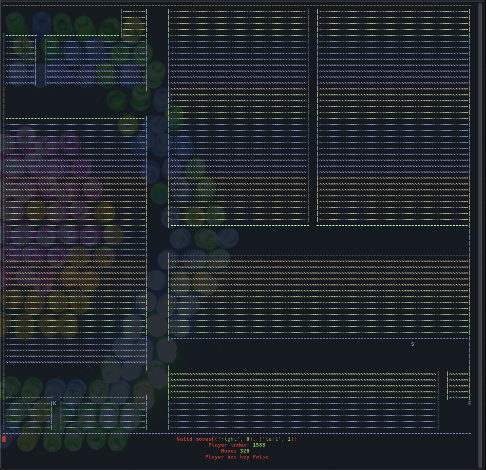

# pyMaze

**Version:** `1.2.0`

### Description

**pyMaze** is an automated terminal-based maze solver rendered in truecolor using the [Rich](https://github.com/Textualize/rich) library. The player (`S`) autonomously explores 10 progressively harder ASCII mazes, locates the key (`K`), and navigates to the exit (`E`) while displaying live telemetry (including a real-time FPS counter and current level) centered at the bottom of the terminal.



---

### Features

- **Dual Pathfinding Modes (`greedy` vs `astar`)**:
  - **Greedy Least-Visited (`default`)**: Explores neighboring corridors by selecting the least-visited adjacent tile (`Player_count`), gradually filling dead ends and backtracking until it finds the key and exit.
  - **A\* Shortest Path (`--astar` / `-a`)**: Uses A\* search (`heapq`) with a Manhattan distance heuristic to compute the optimal path from `S` $\rightarrow$ `K` and then `K` $\rightarrow$ `E`.
- **10 Progressive Levels (`map1.txt` – `map10.txt`)**:
  - Each level uses structured `|~~~|` / `|---|` architectural rooms and winding corridors with strictly increasing path complexity from Level 1 (`140` optimal moves) up to Level 10 (`554` optimal moves).
- **Live FPS Counter & Target FPS Switch (`--fps` / `-f`)**:
  - Displays smoothed real-time frames-per-second in the telemetry bar and lets you customize the frame rate (default `30` FPS).
- **Continuous Loop Mode (`--loop` / `-l`)**:
  - Automatically wraps from Level 10 back to Level 1 for continuous demo playback.
- **Victory Animation & Interactive Buttons**:
  - Completing Level 10 displays an animated trophy screen with interactive **`[ Start Again (R) ]`** and **`[ Exit Program (Q) ]`** buttons (selectable with `←`/`→`/`Tab` + `Enter`, or hotkeys `R` / `Q`).
- **2D Visual Map Files**:
  - Maps (`map1.txt` … `map10.txt`) are stored as human-readable 25-row by 79-column 2D ASCII grids that can be viewed and edited directly in any text editor.
- **Full-Terminal Responsive Scaling & `Rich.Live` Rendering**:
  - Automatically scales the maze horizontally and vertically to fill the active terminal dimensions inside a flicker-free `Rich.Live` alternate screen.

---

### 10-Level Progression & Pathfinding Comparison

| Level | Map File | A\* Optimal Moves (`S → K` + `K → E`) | Greedy Least-Visited Moves |
| :---: | :--- | :---: | :---: |
| **1** | `map1.txt` | **140** *(63 + 77)* | **1,054** |
| **2** | `map2.txt` | **142** *(60 + 82)* | **1,798** |
| **3** | `map3.txt` | **172** *(87 + 85)* | **1,242** |
| **4** | `map4.txt` | **204** *(128 + 76)* | **486** |
| **5** | `map5.txt` | **236** *(96 + 140)* | **3,032** |
| **6** | `map6.txt` | **248** *(94 + 154)* | **2,906** |
| **7** | `map7.txt` | **378** *(202 + 176)* | **1,440** |
| **8** | `map8.txt` | **390** *(252 + 138)* | **2,122** |
| **9** | `map9.txt` | **402** *(346 + 56)* | **1,592** |
| **10** | `map10.txt` | **554** *(476 + 78)* | **568** |

---

### Command-Line Options

| Flag | Long Flag | Description |
| :---: | :--- | :--- |
| `-a` | `--astar` | Use the **A\*** pathfinding algorithm instead of the default least-visited greedy walk |
| `-p` | `--pathfinding {greedy,astar}` | Explicitly select the pathfinding algorithm (`greedy` or `astar`) |
| `-l` | `--loop` | Continuously loop through all 10 levels (`1 → 10 → 1 ...`) |
| `-f` | `--fps <float>` | Set target frames-per-second for rendering (default: `30`) |
| `-v` | `--version` | Print the program version (`pyMaze 1.2.0`) and exit |
| `-h` | `--help` | Show the help message and exit |

---

### Map Legend & 2D File Format

Each map file (`map1.txt` … `map10.txt`) is a 25-row by 79-column 2D ASCII grid:

| Symbol | Meaning |
| :---: | :--- |
| `S` | Player start / current position |
| `K` | Level key (required to unlock the exit) |
| `E` | Level exit |
| Space (` `) or `@` | Walkable corridor tile |
| `-` / `\|` | Horizontal and vertical maze walls |
| `~` | Interior wall block fill |

---

### Installation & Usage

1. **Clone the repository**:
   ```bash
   git clone https://github.com/Frankmau5/pyMaze.git
   cd pyMaze
   ```

2. **Create a virtual environment and install dependencies**:
   ```bash
   python3 -m venv .venv
   source .venv/bin/activate
   pip install -r requirements.txt
   ```

3. **Run the program**:
   ```bash
   # Default greedy least-visited pathfinding across all 10 levels
   python main.py

   # A* shortest-path pathfinding
   python main.py --astar

   # Loop all 10 levels continuously at 60 FPS using A*
   python main.py --astar --loop --fps 60
   ```
   Press `Ctrl+C` at any time to stop the simulation and restore the terminal.
